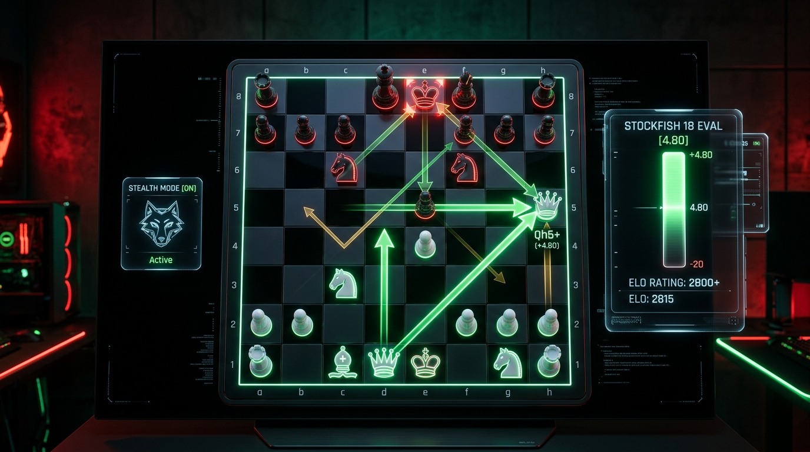
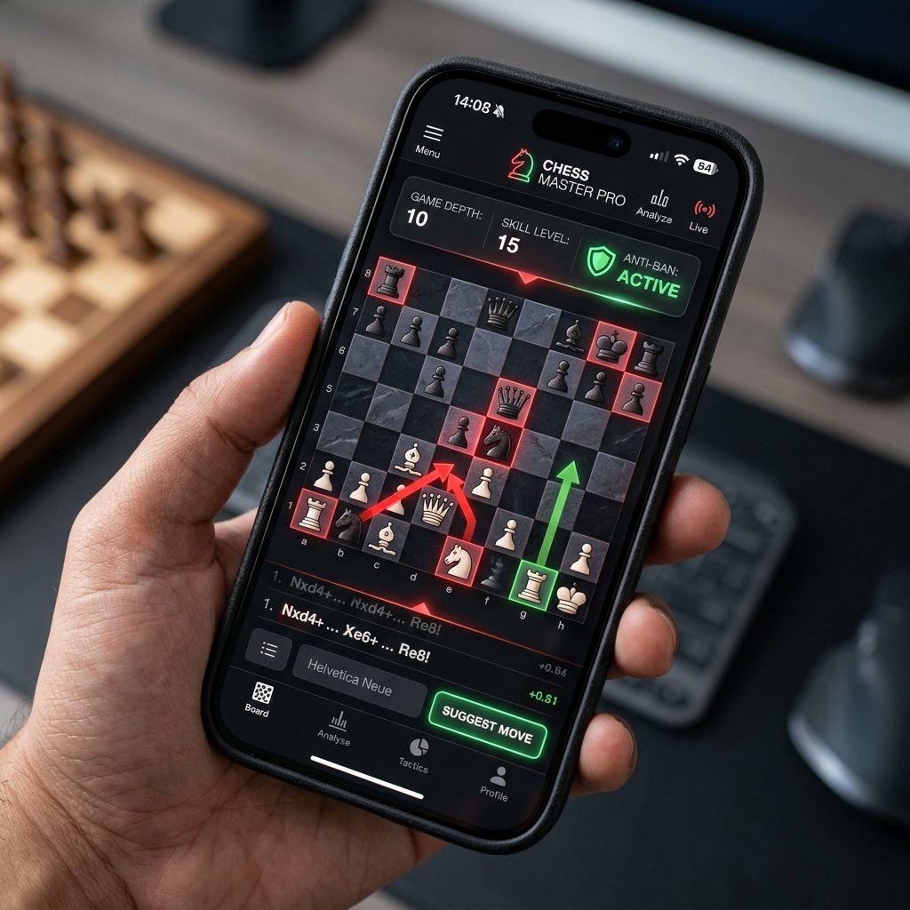
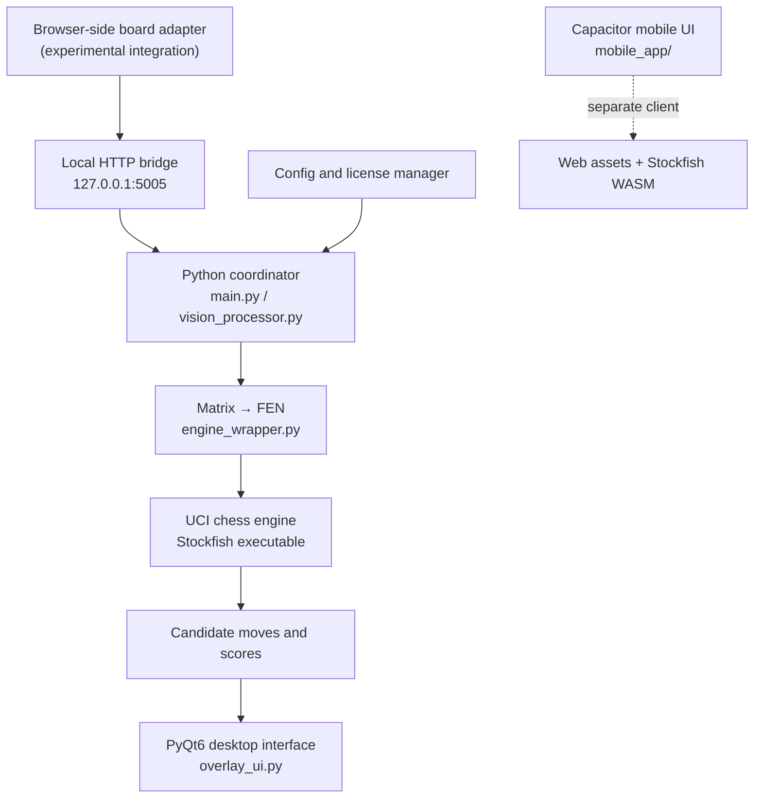

<!--
Stealth Chess V2 — repository README
This README describes the codebase transparently. It does not endorse engine assistance in games where it is prohibited.
-->

<p align="center">
  
</p>

<h1 align="center">Stealth Chess V2</h1>

<p align="center">
  <strong>A modular chess-engine integration prototype for desktop, browser, and mobile experiments.</strong>
  <br />
  Python · JavaScript · PyQt6 · Stockfish UCI · Capacitor
</p>

<p align="center">
  
  
  
  
  
</p>

<p align="center">
  <a href="#overview">Overview</a> ·
  <a href="#architecture">Architecture</a> ·
  <a href="#project-layout">Project layout</a> ·
  <a href="#development-setup">Development setup</a> ·
  <a href="#security-and-fair-play">Fair play & security</a>
</p>

<p align="center">
  
  
</p>

<p align="center"><em>Repository visual assets for product context; these images are showcase artwork/mock-ups, not independent verification of released-build behavior.</em></p>

---

## Overview

**Stealth Chess V2** is an experimental chess-software codebase that connects a browser-side board-state reader to a Python desktop application and a Stockfish-compatible chess engine. The repository also contains a browser userscript, a Capacitor-based mobile interface, a bilingual web storefront, and utilities for packaging and license management.

At a technical level, the project explores how board state can be represented as an 8×8 matrix, converted to **Forsyth–Edwards Notation (FEN)**, evaluated by a UCI chess engine, and presented through a graphical interface. The codebase is useful to developers studying desktop overlays, browser-to-local-app communication, chess-engine integration, and cross-platform UI packaging.

> **Important — fair play:** The repository contains browser integrations for Chess.com and Lichess, plus overlay and screen-capture-related code. Engine assistance during a live or rated game can violate a platform's rules and undermine fair play. Do not use this project in rated, competitive, tournament, or other settings where outside assistance is not explicitly permitted. A hidden overlay or screen-capture setting does **not** make such use permissible, undetectable, or risk-free. This project is not affiliated with or endorsed by Chess.com or Lichess.

## Highlights

- **Python desktop interface:** A PyQt6 application coordinates configuration, engine state, licensing checks, and overlay rendering.
- **Chess-engine bridge:** The engine wrapper communicates with a Stockfish-compatible executable over the UCI protocol and can request multiple candidate moves.
- **Board representation:** Board matrices are converted into FEN before engine analysis.
- **Local communication layer:** A small HTTP service binds to `127.0.0.1:5005` for communication between local components.
- **Browser-side experiments:** A Manifest V3 extension and a separate userscript are included in the source tree.
- **Overlay rendering:** The desktop UI contains transparent, always-on-top drawing functionality, board-coordinate calibration, move arrows, and display options.
- **Mobile UI experiment:** The `mobile_app/` directory contains a Capacitor project, web assets, and Stockfish WebAssembly assets, alongside Android and iOS project files.
- **Bilingual storefront:** The `web_shop/` directory contains an Arabic/English static website and visual assets.
- **Developer utilities:** Packaging, license-generation, encryption, Discord, and deployment-related scripts live under `dev_tools/` and the repository root.

These are descriptions of code present in the repository, **not a claim that every component is production-ready, fully tested, or currently compatible with every device or platform**.

## Architecture

The main desktop analysis path is organized around these components:



The browser connector, desktop program, mobile shell, and storefront are separate pieces. They should not be assumed to share the same runtime or feature set.

## Project layout

| Path | Purpose |
| --- | --- |
| `main.py` | Desktop application entry point, UI coordination, worker loop, and app controls |
| `config.py` | Engine, overlay, hotkey, and license-service configuration |
| `engine_wrapper.py` | Stockfish/UCI process wrapper, FEN conversion, and candidate-move analysis |
| `vision_processor.py` | Local HTTP bridge and board-state storage |
| `overlay_ui.py` | PyQt6 transparent overlay and arrow rendering |
| `licensing.py` | License verification and device-binding logic |
| `extension/` | Chromium Manifest V3 browser-extension source |
| `chess_com_live_sync.user.js` | Browser userscript for live page synchronization |
| `tools/` | Additional userscript copy and related tools |
| `mobile_app/` | Capacitor application, web UI, WebAssembly assets, Android/iOS project files |
| `web_shop/` | Bilingual storefront source, styles, scripts, and image assets |
| `dev_tools/` | Build, license-generation/encryption, and support utilities |
| `guide_ar.md` | Arabic operations and project guide (some instructions may be legacy; verify paths before following them) |
| `requirements.txt` | Python package dependencies |
| `StealthChessHelper.apk` | Checked-in Android package artifact |
| `mobile_app/ios/App/StealthChessHelper.ipa` | Checked-in iOS package artifact |

## Technology stack

| Layer | Technologies visible in this repository |
| --- | --- |
| Desktop application | Python, PyQt6, keyboard hotkeys, MSS |
| Chess rules and positions | python-chess, FEN |
| Engine | Stockfish-compatible UCI executable |
| Board processing / support | OpenCV, NumPy |
| Browser integration | JavaScript, Manifest V3 extension, userscript |
| Mobile shell | Capacitor 6, HTML, CSS, JavaScript, Android/iOS project files |
| Web UI | HTML, CSS, JavaScript |
| Licensing / support tools | Python scripts and remote license-data references |

## Development setup

The steps below prepare a **local development environment** for inspecting and working on the Python desktop code. They do not configure the browser connector, and they are not instructions for using engine assistance in a live game.

### Requirements

- Windows is the primary target for the current desktop overlay implementation; several display and hotkey behaviors are OS-specific.
- A supported Python installation and pip.
- The Python dependencies listed in `requirements.txt`.
- A compatible Stockfish executable obtained from its official distribution and stored/configured locally. The default path in `config.py` is `stockfish-windows-x86-64-avx2.exe`; adjust `Config.STOCKFISH_PATH` if your executable is elsewhere.
- Node.js/npm only if you plan to inspect or work on the Capacitor mobile project.

### Prepare the Python environment

From the repository root in PowerShell:

```powershell
py -m venv .venv
.\.venv\Scripts\Activate.ps1
python -m pip install --upgrade pip
pip install -r requirements.txt
```

If PowerShell blocks virtual-environment activation, follow the policy appropriate for your machine or use the environment's Python executable directly. Avoid changing system-wide execution policies just to run this project.

### Configure the engine

Open `config.py` and set `Config.STOCKFISH_PATH` to the path of the locally installed engine. The desktop wrapper reports an error if it cannot find the configured executable. Review the engine's own licensing and distribution terms before redistributing its binary.

### Desktop development entry point

The Python GUI entry point is `main.py`. Before running it, review the code and configuration, use a test/study environment where engine assistance is permitted, and keep the browser integration disconnected from live or rated play.

The mobile project is maintained separately under `mobile_app/`. Its package script named `build` currently only prints a packaging-readiness message, so it should **not** be treated as a complete production build pipeline without further work.

## Images and visual assets

The repository currently includes the project logo and storefront/mobile showcase artwork:

- [Project logo](logo.png)
- [Storefront showcase image](web_shop/assets/hero_showcase.jpg)
- [Mobile mock-up](web_shop/assets/mobile_mockup.jpg)

The logo is embedded at the top of this README. The architecture diagram above provides a code-level overview; screenshots and mock-ups should be checked against the current application before being presented as proof of working functionality.

## Security, privacy, and fair play

Please review these points before distributing builds or inviting outside contributors:

1. **Fair-play boundaries:** Browser-board integrations and engine suggestions should only be used in environments where they are expressly allowed, such as suitable study, analysis, or development contexts. Do not use this project to obtain prohibited assistance in competitive play.
2. **No anti-cheat guarantee:** The code contains screen-capture/display-affinity behavior and humanized-delay options. These are implementation details, not proof of safety, invisibility, or immunity from detection. This README does not endorse bypassing platform rules.
3. **Embedded license material:** The source currently contains hard-coded licensing key material and references a remote license-data endpoint. Treat these values as exposed because the repository is public. Rotate/re-design sensitive license material, move secrets to a server-side system, and audit the license flow before any commercial distribution.
4. **Device identifiers:** The license manager attempts to derive a device identifier on Windows. Review the privacy implications and disclose this behavior clearly to end users before distribution.
5. **Binary artifacts:** The repository contains APK/IPA binaries. A checked-in artifact is not automatically a verified or safe release. Consider publishing versioned builds through GitHub Releases, with checksums and reproducible build instructions.
6. **Local HTTP bridge:** The bridge is designed for loopback communication. Keep it bound to `127.0.0.1`; do not expose it to a public network without a proper threat model, authentication, input validation, and origin protections.
7. **Dependencies and tests:** Review dependencies before installing them. No comprehensive automated test suite or verified release pipeline is documented here; test changes on a separate branch and avoid treating the current code as production-hardened.

If you discover a security issue, avoid publishing real license keys, personal data, or other secrets in an issue or pull request.

## Current limitations and suggested next steps

- Add a dedicated **offline study mode** based on manually supplied FEN/PGN positions, without requiring a live-site adapter.
- Separate permitted analysis workflows from browser integration and remove any misleading claims about hiding from monitoring or avoiding bans.
- Add automated tests for board-matrix-to-FEN conversion, turn/orientation detection, engine communication, and overlay-coordinate mapping.
- Add a documented, reproducible build workflow for Windows, Android, and iOS.
- Pin Python dependency versions and document supported Python/Windows versions.
- Remove hard-coded secrets and define a root-level `LICENSE` before inviting contributions or promising reuse rights.
- Move large binary builds to GitHub Releases where appropriate, leaving source and build instructions in the repository.
- Refresh `guide_ar.md` so referenced filenames and commands match the actual directory layout.

## Contributing

Contributions that improve correctness, accessibility, localization, packaging, documentation, testing, and legitimate study workflows are welcome.

1. Open an issue describing the problem or proposed improvement.
2. Create a focused branch.
3. Add tests or reproducible steps for bug fixes where practical.
4. Submit a pull request with a clear summary and any relevant screenshots.

Changes should respect the rules of the platforms being integrated with and should not add or promote evasion of fair-play enforcement.

## License

There is currently no root-level `LICENSE` file in this repository. Until the project owner adds one, reuse and redistribution terms are unspecified; do not assume that the code is open source solely because the repository is public. Third-party components and engine binaries may have their own license obligations.

## Disclaimer

This is an independent experimental project. It is not affiliated with, endorsed by, or sponsored by Chess.com, Lichess, Stockfish, or the Capacitor project. Product names are used only to describe integration points and dependencies.

---

## ملخص عربي

**Stealth Chess V2** مشروع تجريبي يجمع بين تطبيق سطح مكتب مكتوب بـ Python وPyQt6، وربط محرك شطرنج متوافق مع Stockfish، وملحق/سكربت للمتصفح، وواجهة موبايل مبنية باستخدام Capacitor، وموقع ويب عربي/إنجليزي.

الملفات الأساسية هي `main.py` لواجهة سطح المكتب، و`engine_wrapper.py` للتواصل مع المحرك، و`vision_processor.py` لجسر الاتصال المحلي، و`overlay_ui.py` للرسم، و`mobile_app/` لواجهة الموبايل، و`web_shop/` لموقع الويب.

**تنبيه:** يحتوي المستودع على تكامل مع صفحات لعب مباشرة وميزات تراكب/إخفاء من التقاط الشاشة. يجب استخدامه فقط في التدريب والتحليل والبيئات التي تسمح صراحةً بمساعدة المحركات، وليس في مباريات مصنّفة أو تنافسية حيث تكون هذه المساعدة ممنوعة. كما يجب معالجة مفاتيح الترخيص المضمّنة في الكود قبل أي توزيع تجاري، وإضافة ملف ترخيص واضح للمشروع.
